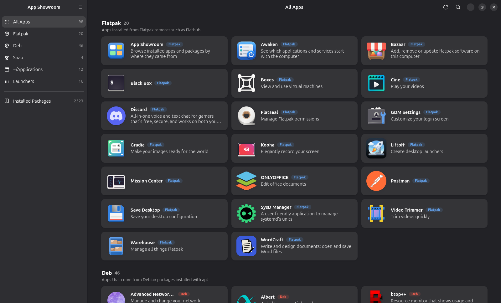

<div align="center">


# App Showroom

**See every app on your computer, sorted by where it came from.**

</div>

## Install

Download [`io.github.martins.AppShowroom.flatpak`](io.github.martins.AppShowroom.flatpak) and run:

```sh
flatpak install io.github.martins.AppShowroom.flatpak
```



Flatpaks, Debs, Snaps, AppImages in `~/Applications` and every installed package, all in one tidy place. Just start typing to search, and click any app to see where it lives.

<video src="https://github.com/martinszeltins/gnome-app-showroom/raw/master/screencast.webm" controls muted width="100%"></video>
